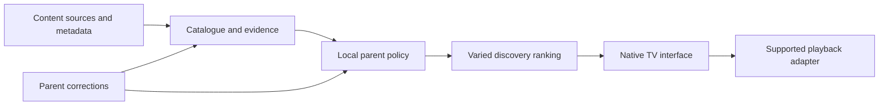

# Proposed architecture

Status: design proposal; no application components have been implemented here.

The YouTube-backed proposal has unresolved policy dependencies. The
[policy review](youtube-policy-review.md) supersedes any inference that an official
player plus custom classification is already an allowed integration. Keep generic
policy, ranking, and TV experiments independent of a specific content provider.

## Component flow

## Platform

For a verified Fire OS target, start with Kotlin and native TV navigation. Keep the
policy core independent of the screen and playback adapter. A small shared
JavaScript/TypeScript library is a candidate for the extracted FilterTube helpers;
the feasibility experiment must select its runtime or an equivalent native port.

Vega OS is a distinct target and needs its own platform assessment. Avoid committing
to multi-platform abstractions before the first device works.

## Catalogue and evidence

Normalize public video and channel identifiers, source references, titles,
descriptions, durations, language evidence, and available playback metadata.
Keep content labels separate from family preferences so a parent can change a
preference without classifying every video again.

Each label includes a category, assessment, confidence, evidence basis, source,
classifier or reviewer version, and timestamp. Missing evidence must remain
explicit. Source-level knowledge can inform a decision but does not guarantee
that every upload from that source is suitable.

Official YouTube Data API metadata is a candidate input, not a documented export
of the YouTube Kids catalogue or a replacement for its age policies. The
`madeForKids` flag identifies child-directed content; it does not establish an
age rating, educational quality, absence of marketing, or parental approval.

Begin with a catalogue preparation tool on a development computer and local
profile storage on the TV. Add a hosted service only if the trial establishes a
need. Respect data retention and refresh requirements of each source.

## Policy and ranking

The deterministic policy layer returns eligible, excluded, or needs-review, along
with reasons and the policy version. Define precedence between age constraints,
parent hide rules, explicit exceptions, and soft preferences. Soft preferences
affect ranking only after eligibility is established.

Ranking combines interests, familiarity, novelty, and creator/format variety.
Avoid optimizing solely for watch time. Persist only the local activity needed
for agreed user-facing functions, and provide reset/export controls. Parent
profiles, sensitive settings, and policy writes remain native-owned.

## Playback decision gate

Use an isolated playback adapter so content selection does not depend on one
provider. Test the official YouTube embedded-player path first. Investigate
referrer/app identification requirements and device compatibility explicitly.

A managed web surface may help evaluate FilterTube reuse, but is not a settled
production choice. Page interception, DOM hooks, native bridges, session handling,
and distribution requirements need separate assessment.

Do not assume that hiding surrounding recommendations also removes embedded-player
links or end screens. YouTube does not provide a complete related-video disable
switch, and its policies constrain altering players, links, and advertisements.
If the required child experience cannot be achieved through a supportable
integration, revise the content-source strategy before proceeding.

The ordinary app cannot intercept Fire TV's Home button. App-level parent settings
do not lock the entire television or prevent access to other installed apps.
Device-level controls are a separate setup concern.

## Privacy and release boundaries

Use synthetic fixtures and public content for development. Household research,
children's histories, credentials, network captures, and device identifiers stay
outside the public repository. Do not include third-party analytics in the family
prototype by default or send child activity to a classifier as an incidental
implementation choice.

Before a public child-directed release, review the chosen provider's policies,
Amazon distribution requirements, data flows, and applicable child-privacy
obligations. A technically successful experiment does not establish distribution
eligibility.

## Verification

Policy tests should cover precedence, missing metadata, unknown classifications,
explicit exceptions, and policy changes between feed display and selection.
Playback and remote acceptance checks must run on hardware. Classifier quality
needs a labelled held-out sample and a separate accounting of abstentions.

## References

- [Fire OS overview](https://developer.amazon.com/docs/fire-tv/fire-os-overview.html)
- [Fire TV remote input](https://developer.amazon.com/docs/fire-tv/remote-input.html)
- [YouTube player parameters](https://developers.google.com/youtube/player_parameters)
- [Embedded-player identification requirements](https://developers.google.com/youtube/terms/required-minimum-functionality)
- [YouTube developer policies](https://developers.google.com/youtube/terms/developer-policies)
- [Video metadata](https://developers.google.com/youtube/data/reference/rest/v3/videos)
